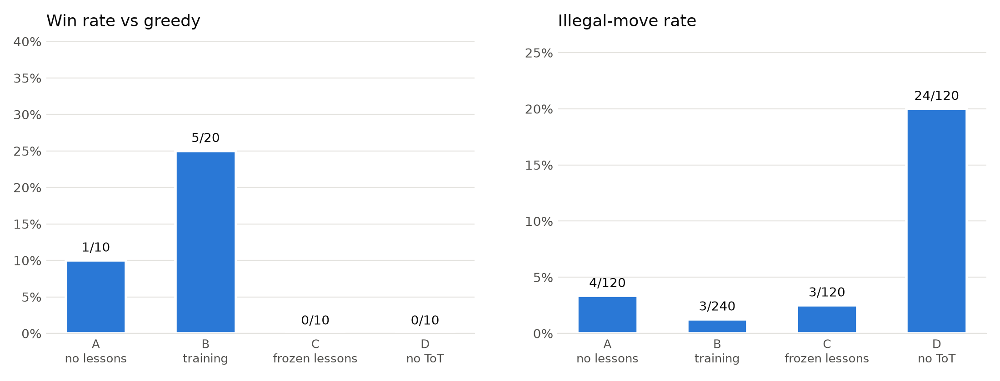

# FrontLine-Strategy-Agents

FrontLine is a 5x5 territory game where an LLM agent plays, a crew of LLM agents reviews each game, and only the lessons that win are kept. It is a CMU Agentic AI capstone project. The research question: **can an agent get better at a game by writing and keeping its own lessons, without changing model weights?**

The core rule: **the game engine is deterministic Python with no LLM.** Everything that uses an LLM wraps around it, so a bad move can always be traced to the agent, never to the rules.

## The game in 30 seconds

- 5x5 board. Coral's home is A1, Teal's is E5. Each player gets 12 turns.
- One action per turn: **claim** an empty adjacent cell, **reinforce** a cell (+1, max 5), or **attack** an adjacent enemy cell.
- Attack power = attacker's strength + 1 for each other friendly cell touching the target. Higher than the defender's strength captures it.
- **Supply:** cells not connected to your home lose 1 strength per turn.
- Capture the enemy home to win. Otherwise the player with the most cells after 24 turns wins (then total strength, then draw).
- Illegal moves forfeit the turn.

Full rules with a worked example: [docs/rules.md](docs/rules.md).

## Architecture

```
   Lesson store  ──top-3 by board similarity──┐
   (cap 30, W/L tally,                        ▼
    retire rule)        ┌──── LangGraph match loop, one pass per turn ────┐
        ▲               │ observe → retrieve → decide → validate → apply  │──┐
        │               └─────────────────────────┬───────────────────────┘  │ next turn
        │                                         │                          │
        │                       Player Agent (Ollama, qwen3:32b):            │
        │                       tools + tree-of-thought, 3 candidates,       │
        │                       engine scores each 2-ply, LLM picks one      │
        │                                                                    ▼
        │                                                     game over: trace + OTel spans
        │                                                                    │
        └──── new / merged lesson ──── CrewAI review crew ◄──────────────────┘
                                       analyst → critic → curator
                                       (sees moves and boards only)
```

| Module | What it does |
|---|---|
| [`engine.py`](frontline/engine.py) | Rules as pure functions (`step`, `legal_moves`, `check_action`, `attack_power`, `supplied_cells`) plus an OpenSpiel-style `Game` wrapper that records every turn |
| [`schemas.py`](frontline/schemas.py) | Pydantic data contracts: `GameState`, `Action`, `TurnRecord`, `Lesson`. `Action`'s field descriptions become the LLM's JSON schema |
| [`match.py`](frontline/match.py) | LangGraph loop `observe → retrieve → decide → validate → apply`. Only `decide` calls an LLM. Illegal moves are recorded, then forfeit the turn |
| [`player.py`](frontline/player.py) | `PlayerAgent`: legal moves and retrieved lessons in the prompt, up to 4 rounds of tool calls, then tree-of-thought (3 candidates → engine 2-ply scores → LLM picks). A parse error becomes an illegal move, not a crash |
| [`tools.py`](frontline/tools.py) | Read-only tools that do the math: `preview_attack`, `supply_check`, `threat_scan`, `score_2ply` |
| [`lessons.py`](frontline/lessons.py) | JSON lesson store with vector search. A board embeds as 25 signed cell strengths (from the mover's side) plus turn/24; search is cosine top-k |
| [`crew.py`](frontline/crew.py), [`review.py`](frontline/review.py) | CrewAI review crew: the **analyst** finds the turning point, the **critic** rejects claims the boards don't support, the **curator** adds, merges, or skips |
| [`tracing.py`](frontline/tracing.py) | In-memory OpenTelemetry exporter. Span tree: `game → turn ×24 → retrieve / decide / validate / apply`, tool calls and candidates as events |
| [`bots.py`](frontline/bots.py) | `RandomBot` and `GreedyBot` baselines |

### How lessons are kept honest

- **The crew never sees the player's reasoning.** It gets a stripped trace (moves and boards only, no `reason`, `cited_lessons`, or candidates), so it judges what happened rather than what the player said it was doing.
- **Two checks per lesson:** the critic tests it against the boards now, and a win/loss tally tests it in later games.
- **Only cited lessons are scored.** A lesson that was retrieved but ignored gets no credit or blame.
- **Confidence** = (wins + 1) / (games + 2). After 3 cited games at ≥ 0.5 a candidate becomes active; after 5 cited games below 0.4 it is retired.
- **Cap of 30 live lessons.** Over the cap, the lowest-confidence lesson is retired.

More design detail: [docs/architecture.md](docs/architecture.md).

## Setup

Requires Python 3.13 (pinned in `.python-version`), [uv](https://docs.astral.sh/uv/), and [Ollama](https://ollama.com) for the LLM parts.

```bash
uv sync                 # install dependencies
uv run pytest           # 26 tests, one per rule in docs/rules.md; no LLM needed

# For LLM games:
brew install ollama     # or see ollama.com for Linux/Windows
ollama serve            # leave running
ollama pull qwen3:32b   # ~20 GB; needs ~32 GB RAM. Use --model qwen3:8b on smaller machines
```

## Usage

Everything except the LLM player and review crew runs without Ollama.

```bash
# Bots only (no LLM, instant)
uv run python scripts/run_bots.py --games 1000 --a greedy --b greedy      # bot win rates
uv run python scripts/run_match.py --coral greedy --teal random           # one game, board printed each turn

# LLM agent (coral) vs greedy (teal)
uv run python scripts/run_match.py                                        # one game, watch it think
uv run python scripts/run_match.py --games 10 --quiet                     # illegal-move rate over 10 games
uv run python scripts/run_match.py --no-tot                               # single candidate, no tree-of-thought
uv run python scripts/run_match.py --games 2 --lessons lessons/lessons.json --review   # learn between games

# Review saved games and update a lesson store
uv run python scripts/run_review.py traces/*.json --lessons lessons/lessons.json
```

Single games write `traces/<game_id>.json` (every turn: board before/after, move, legality, candidates and scores, retrieved lessons) and `traces/<game_id>.spans.json` (OpenTelemetry spans).

## Running the experiment

[`scripts/run_experiment.py`](scripts/run_experiment.py) runs four conditions against the greedy bot, with the first mover alternating:

| Condition | Lessons | Review crew | Tree-of-thought | Answers |
|---|---|---|---|---|
| **A** baseline | none | no | yes | How good is the agent with no memory? |
| **B** training | on, starts empty | after every game | yes | Does the store fill with lessons that win? |
| **C** frozen eval | B's final store, read-only | no | yes | Did learning help? (compare to A) |
| **D** ablation | B's final store, read-only | no | **no** | Does tree-of-thought matter? (compare to C) |

```bash
uv run python scripts/run_experiment.py --seed 1                               # plan counts: A 50, B 120, C 50, D 30
uv run python scripts/run_experiment.py --seed 1 --a 10 --b 20 --c 10 --d 10   # shorter pass
uv run python scripts/run_experiment.py --seed 2 ...                           # second seed, to separate real gaps from noise
uv run python scripts/run_experiment.py --seed 1 --player greedy --a 4 --b 4 --c 4 --d 4   # smoke test, no LLM
uv run python scripts/run_experiment.py --seed 1 --summary                     # rebuild the summary table
uv run --with matplotlib python scripts/make_charts.py runs/seed1 results/     # charts from a run
```

An LLM game takes about 8 to 15 minutes on qwen3:32b, so run long passes under `tmux` or `nohup`. The runner is built to be left alone:

- **Resumable:** each finished game is a row in `results.csv`. Rerunning the same command skips those games and retries any that failed. Raise a count (e.g. `--b 300`) to extend a condition.
- **Failure guard:** stops after 3 games in a row raise an error.
- **C and D wait for B:** the store is copied to `lessons-frozen.json` only once B finishes, so C and D always test a fully trained, unchanging store.

Output in `runs/seed<N>/`:

| File | Contents |
|---|---|
| `summary.md` | Per-condition wins, win rate, illegal-move rate, how often the LLM picked the top-scored candidate, lessons live, and win rate with vs without a cited lesson. Rewritten after every game |
| `results.csv` | One row per game |
| `log.txt` | One line per game |
| `A/` … `D/` | Turn traces and OTel spans for every game |
| `lessons.json`, `B/lessons-gNNN.json` | The training store, plus a snapshot after each B game |
| `lessons-frozen.json` | The store C and D use |

## Results

Main experiment, seed 1 (Nov 23, 2026; qwen3:32b vs greedy; 50 games, 7.5 hours). Full data, charts, and sample traces: [results/](results/).

| Condition | Win rate | Illegal moves | Picked top-scored move | Avg. cells |
|---|---|---|---|---|
| A, no lessons | 1/10 (10%) | 3% | 72% | 8.4 |
| B, training | 5/20 (25%) | 1% | 82% | 9.3 |
| C, frozen lessons | 0/10 (0%) | 2% | 80% | 8.9 |
| D, no tree-of-thought | 0/10 (0%) | **20%** | – | 7.6 |



- **Tree-of-thought keeps moves legal:** without it, illegal moves rise from 2% to 20%.
- **Frozen lessons did not raise the win rate.** The crew wrote 10 lessons in training and the outcome tally retired 8, so C ran with 2 unproven lessons.
- **Seat dominates:** the agent won 6 of 25 games as first mover and 0 of 25 as second.
- 10 to 20 games per condition shows trends, not significant differences.

Earlier pilot numbers (single LLM call: 12.5% illegal moves) are in [docs/submission-3.md](docs/submission-3.md) and [docs/submission-4.md](docs/submission-4.md). The final report is [docs/final-report.md](docs/final-report.md).

## Repository layout

```
frontline/      the package (engine, agents, lessons, crew, tracing)
scripts/        run_bots, run_match, run_review, run_experiment, make_charts
results/        experiment results, charts, sample traces
tests/          rule tests; fixtures/lessons.json is for tests only, never experiments
lessons/        lesson store from the pilot training runs
docs/           rules, architecture, plan, checkpoint submissions, learning log
```

## License

MIT. See [LICENSE](LICENSE).
