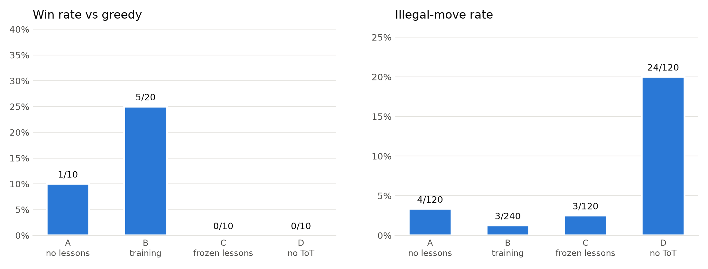
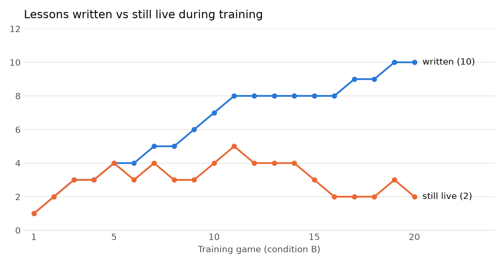

# FrontLine: A Self-Improving Strategy Agent That Writes, Tests, and Retires Its Own Lessons

Chris Teli · CMU Agentic AI Program · Final Capstone Report

Repository: https://github.com/moistvonlipwig/FrontLine-Strategy-Agents

## 1. Problem and user

**Problem.** Finding good strategies in a new game normally takes many rounds of human playtesting. A designer changes a rule, people play, someone notices what wins, and the cycle repeats. A plain LLM can't take over this work. It has no memory between games, it can't reliably apply rules or do the math, and it has no way to check whether its own advice works.

**Intended users.**

- **Game designers and instructors** who want to balance rules and understand which strategies win.
- **Players** who want to learn from strategy lessons that have been tested in play, not just suggested.

**Why it matters.** My background is modeling and simulation, where there is a growing need for agents that build strategies and adapt them against an opponent. The core question applies beyond games: **can an agent get better at a task by writing and keeping its own lessons, without changing model weights?** If it can, the same loop (act, trace, review, keep what works) carries over to any domain with a clear outcome.

## 2. System goal and scope

**Goal.** An agent plays FrontLine, a 5x5 territory game made for this project. A separate crew of agents reviews each game and writes a lesson. The lesson store keeps only the lessons that win.

**FrontLine in brief.** Coral starts at A1 and Teal at E5. Each player gets 12 turns, with one action per turn: claim an empty adjacent cell, reinforce a cell, or attack an adjacent enemy cell. Cells cut off from home lose strength each turn. Capturing the enemy home wins; otherwise the player with the most cells after 24 turns wins. The game is new, so the LLM has no prior knowledge of it.

**What success looks like.**

| Criterion | Target |
|---|---|
| Legality | The agent's illegal-move rate falls well below the 12.5% single-call baseline |
| Learning | With a frozen lesson store (C), the agent beats greedy more often than with no lessons (A) |
| Reasoning | Tree-of-thought (C) beats a single candidate (D) |
| Honest lessons | Lessons that lose get retired, and every lesson can be traced to the game that produced it |

**Boundaries.**

- **One deterministic engine with no LLM.** The rules are plain Python, so a bad move is always the agent's fault, never the rules'.
- **A local model** (qwen3:32b through Ollama). There are no API costs and no data leaves the machine.
- **Agent vs bots only.** Human play is out of scope for the capstone.
- **Lessons only, no fine-tuning.** All learning lives in a readable JSON file.

**Why lessons and not reinforcement learning?** RL learns by updating a policy's weights over thousands to millions of games, and the result plays well but can't explain itself. On a 5x5 board, RL or tree search would very likely play better than FrontLine. But the user is a designer who wants strategies people can read, check, and argue with, and an LLM game takes about 9 minutes, so millions of games aren't an option. FrontLine's learning lives in memory instead: the LLM proposes a lesson in plain English, and game outcomes decide whether it stays. The win-loss tally is a small outcome-driven signal, much like a bandit over lessons. This is the same family as Reflexion, ExpeL, and Voyager, which improve agents by writing reflections or skills rather than by training. In short: RL learns to win; FrontLine aims to explain what wins.

## 3. Final system architecture

```
+--> Lesson store (cap 30, win/loss tally, retire rule)
|      |
|      |  top-3 lessons by board similarity
|      v
|    LangGraph match loop, one pass per turn:
|      observe -> retrieve -> decide -> validate -> apply -> next turn, or game over
|                               |
|                   Player Agent (Ollama, qwen3:32b): read-only tools, then
|                   3 candidates -> engine scores each 2-ply -> LLM picks one
|      |
|      v  game over
|    Trace + OpenTelemetry spans
|      |
|      v
|    CrewAI review crew: analyst -> critic -> curator (sees moves and boards only)
|      |
+------+  new or merged lesson
```

| Concept | Where it lives in FrontLine |
|---|---|
| **Reasoning loop** | A LangGraph state machine runs each turn: observe → retrieve → decide → validate → apply. Only `decide` calls an LLM |
| **Tools** | Read-only tools do the math for the LLM: `preview_attack`, `supply_check`, `threat_scan`. Legal moves are always in the prompt. Up to 4 rounds of tool calls per turn |
| **Tree-of-thought** | The LLM proposes 3 different moves. The engine scores each one 2 levels deep (the move, then the opponent's best reply). The LLM sees the scores and picks one |
| **Memory and retrieval** | A JSON lesson store. Each lesson is filed under the board it came from, as 25 signed cell strengths plus game progress. Each turn, the 3 lessons from the most similar boards (cosine similarity) go into the prompt |
| **Multi-agent coordination** | A CrewAI crew reviews every game. The **analyst** finds the turning point, the **critic** rejects claims the boards don't support, and the **curator** adds, merges, or skips the lesson |
| **Guardrails** | The engine validates every move; illegal moves forfeit the turn. The crew never sees the player's reasoning. Lessons are capped at 30 and retired when they lose |
| **Logging and observability** | Every turn is saved as a trace (boards, move, legality, candidates and scores, retrieved and cited lessons). OpenTelemetry spans cover `game → turn → retrieve / decide / validate / apply`, with tool calls and candidates as events |
| **Evaluation** | An experiment runner plays four conditions (A–D) against a greedy bot and writes a summary table after every game |
| **Human oversight** | Every lesson is plain text with its win-loss record and source game, so a person can read, check, or delete it. Traces and summaries show exactly why each move was made |

**How a lesson earns its place.** Every lesson faces two checks. The critic tests it against the boards when it is written. A win-loss tally then tests it in later games. Only lessons the player actually **cited** get credit or blame, so advice it ignored isn't scored. Confidence is (wins + 1) / (games + 2), so one lucky game can't push a lesson to 100%. After 3 cited games at 0.5 or above, a lesson is promoted to active. After 5 cited games below 0.4, it is retired.

## 4. Design evolution across the program

| Stage | What changed | Why it helped |
|---|---|---|
| **Module 1: proposal** | Two agents (Player and Reviewer) around a rules engine, with tools, memory, and retrieval | Set the core split: the agent that plays is not the one that judges |
| **Module 2: engine and loop** | Wrote the engine myself instead of using OpenSpiel, with 26 tests (one per rule). Bot testing showed the first mover won too often, so the first mover's home now starts at strength 3 and the second mover's at 2 | Greedy vs greedy went to about 54% / 47%, so wins reflect play, not seat |
| **Module 2: tools** | The LLM made 12.5% illegal moves with one call. Rather than asking it to do the math, the tools do it | The LLM reasons about strategy; the code handles arithmetic |
| **Module 3: retrieval** | "Lesson search" moved from an optional tool to an automatic step in the loop. It uses a small cosine search over a JSON file instead of a vector database | The agent can't forget to look up lessons. With at most 30 lessons, a database added nothing |
| **Module 3: scoring** | Only lessons the player cited **and** that were retrieved that turn get credit | The LLM sometimes "cited" words like "expand." Without this check, lessons got credit for moves they didn't cause |
| **Module 4: tree-of-thought** | The original plan had the LLM score its own candidates. The final version has the engine score them 2 levels deep | The engine is exact and fast. Illegal moves dropped from 12.5% to 1–3% |
| **Module 4–5: review crew** | One Reviewer became a 3-role crew. The crew gets a stripped trace with no reasoning, cited lessons, or candidates | The critic catches unsupported claims. Hiding the reasoning makes the crew judge what happened, not what the player said |
| **Module 6: reliability** | A 2,000-token output cap after an LLM call hung. Parse errors become an illegal move instead of a crash. The experiment runner resumes after a crash and stops after 3 errors in a row | Long unattended runs finish, and every failure is counted instead of lost |

The biggest lesson from the evolution: **every time the LLM was asked to calculate, it failed, and every time code took over the calculation, the system improved.** The final design gives the LLM only the parts that need judgment: which plan to try, which candidate to pick, and what lesson to draw from a game.

## 5. Implementation overview

| Part | Technology | Role |
|---|---|---|
| Language and setup | Python 3.13, uv | Reproducible install with `uv sync` |
| Game engine | Plain Python, OpenSpiel-style names (`get_state`, `legal_moves`, `apply`) | Deterministic rules, move validation, supply, win checks |
| Data contracts | Pydantic | `GameState`, `Action`, `TurnRecord`, `Lesson`. The `Action` schema also constrains the LLM's JSON output |
| Match loop | LangGraph | The turn state machine; each node is traced |
| Player Agent | LangChain `ChatOllama` | Tool calling and structured output |
| Model | qwen3:32b through Ollama, run locally | Temperature 0, 2,000-token cap |
| Review crew | CrewAI | Analyst, critic, and curator with structured outputs |
| Lesson store | JSON plus a small cosine search | Readable by people, versioned with git |
| Tracing | OpenTelemetry SDK with an in-memory exporter, saved as JSON | One span tree per game |
| Baselines | `RandomBot`, `GreedyBot` | Opponents and sanity checks |
| Experiment runner | `scripts/run_experiment.py` | Runs the A–D conditions, resumable, with a failure guard and a summary table |

The code is about 1,500 lines in `frontline/` and `scripts/`, with 26 tests. MCP was not used: everything runs in one Python process, and LangGraph already passes the state between steps.

## 6. Evaluation and results

**Method.** The agent plays the greedy bot, which takes the move with the best immediate score. The first mover alternates every game. Four conditions:

| Condition | Lessons | Review crew | Tree-of-thought | Question |
|---|---|---|---|---|
| **A** baseline | none | no | yes | How good is the agent with no memory? |
| **B** training | on, starts empty | after every game | yes | Does the store fill with lessons that win? |
| **C** frozen eval | B's final store, read-only | no | yes | Did learning help? (C vs A) |
| **D** ablation | B's final store, read-only | no | no | Does tree-of-thought help? (C vs D) |

The store is frozen before C so the test measures what the agent learned, without it still learning during the test.

**Metrics.** Win rate vs greedy, illegal-move rate, how often the agent picked the engine's top-scored candidate, average cells at the end, lessons live after training, and win rate in games where a lesson was cited vs not.

**Pilot results (October, small samples).**

| Measure | Result |
|---|---|
| Illegal-move rate, single LLM call | 15/120 = 12.5% |
| Illegal-move rate, with tools and tree-of-thought | 1–3% |
| Wins vs greedy, lessons off / on (10 games each) | 1/10 / 1/10 |
| Average cells at end, lessons off / on | 8.0 / 8.9 |
| Agent picked the engine's top-scored candidate | 179/239 turns (75%) |
| Illegal tree-of-thought candidates, filtered before scoring | 91/717 (13%) |
| Lessons still live after 20 training games | 4 of 11 (7 retired) |

**Main experiment (seed 1, November 23: 50 games, 7.5 hours, no errors).**

| Condition | Games | Win rate | Illegal moves | Picked top-scored move | Avg. cells | Lessons live |
|---|---|---|---|---|---|---|
| A, no lessons | 10 | 1/10 (10%) | 4/120 (3%) | 72% | 8.4 | 0 |
| B, training | 20 | 5/20 (25%) | 3/240 (1%) | 82% | 9.3 | 2 of 10 written |
| C, frozen lessons | 10 | 0/10 (0%) | 3/120 (2%) | 80% | 8.9 | 2 |
| D, no tree-of-thought | 10 | 0/10 (0%) | 24/120 (20%) | – | 7.6 | 2 |





The data, charts, and one sample trace per condition are in `results/` in the repository.

**Findings.**

- **Tree-of-thought keeps moves legal (C vs D).** Without it, illegal moves rose from 2% to 20%, and the agent ended with fewer cells (7.6 vs 8.9). This is the clearest result.
- **The frozen lessons did not raise the win rate (C vs A).** C won 0 of 10 and A won 1 of 10. C did end with slightly more cells (8.9 vs 8.4) and picked the top-scored move more often (80% vs 72%).
- **The outcome tally retired most lessons.** The crew wrote 10 lessons during training, and 8 were retired after losing 4 or 5 of the games where they were cited. C and D ran with only 2 lessons, both unproven (1 win and 2 losses; 0 wins and 1 loss). In 20 games the crew wrote lessons faster than the tally could prove any of them.
- **Training (B) did best, at 5 of 20,** but all 5 wins came as first mover. 20 games can't separate that from noise.
- **Seat mattered more than anything else.** Across all 50 games the agent won 6 of 25 as first mover and 0 of 25 as second mover.

**Example: a lesson that hurt.** In pilot game on2-g01, turn 14, the agent followed lesson L9 ("attack cells next to the opponent's home") and attacked C3, scoring -56, instead of claiming A3, scoring -23. C3 is not next to Teal's home, so the agent misapplied the lesson. I replayed 7 such turns without lessons: the agent chose a different move on 6 of them, and on all 6 the move made with lessons scored lower. The tally caught it but too slowly: in the pilot store, L9 sits at 0 wins and 2 losses, still live, because retirement needs 5 cited games. That delay is the cost of not retiring a lesson after one unlucky game.

**What the results show.**

- **Strength:** tools and tree-of-thought nearly eliminated illegal moves, and the ablation confirms tree-of-thought is the reason. The agent's reasoning is fully traceable, and bad lessons are found and retired without a person stepping in.
- **Limitation:** lessons change the agent's moves but have not yet raised its win rate, in the pilot or in the main run. The safeguards work, but in 20 training games they reject lessons faster than good ones are found.

With 10 to 20 games per condition, these are trends, not statistically significant differences. The honest conclusion is that the system's reasoning and safety parts work as designed, and that showing learning needs more training games and a second seed.

## 7. Safety and reliability

**Guardrails.**

- **The engine is the authority.** Every move is validated by deterministic code. An illegal move is logged with its reason and forfeits the turn; it is never applied.
- **Structured output.** The LLM's answer must match a Pydantic schema, including a cell-name pattern. A reply that can't be parsed becomes an illegal move, so one bad answer never crashes a game.
- **Read-only tools.** Tools can look at the board but can't change it.
- **Cost limits.** Each LLM answer is capped at 2,000 tokens, tool calls at 4 rounds per turn, and the 2-ply scoring is plain Python.
- **Memory-poisoning defenses.** The review crew sees only moves and boards, never the player's reasoning, so a player can't talk the crew into a lesson. The critic must approve every lesson against the boards. The store holds at most 30 lessons, and lessons that keep losing are retired automatically.

**Fallback logic.**

- If the LLM's pick among the 3 candidates can't be read, the agent plays the top-scored candidate.
- If its candidate list can't be read, the turn counts as illegal and the game continues.
- The experiment runner saves each finished game before starting the next. A rerun skips finished games. It stops after 3 errors in a row instead of running on broken.
- The lesson store is saved after every training game, with a snapshot of each version, so any bad change can be rolled back.

**Monitoring.** Every game writes a turn-by-turn trace and an OpenTelemetry span tree. The runner writes one log line per game and a summary table after each game, readable from a phone.

**Human oversight.** Lessons are plain sentences with a trigger, a win-loss record, and the game they came from. A person can read the whole store in a few minutes, trace any lesson back to its source game, and edit or retire it. Every move in every game can be explained from its trace. There is no live human approval step during play; that is planned for when humans play the agent (see section 8).

## 8. Limitations and next steps

**Limitations.**

1. **The LLM can overrule a better move.** It picked the engine's top-scored candidate on only 72–82% of turns, sometimes because a lesson pushed it the other way.
2. **Lessons can be misapplied.** Board similarity finds positions that look alike but can differ in one cell that matters, as the L9 example shows.
3. **Small samples.** 10 to 20 games per condition shows a trend, not proof. A second seed is needed to separate real gaps from noise.
4. **Lessons don't survive long enough to prove themselves.** In 20 training games the crew wrote 10 lessons and the tally retired 8. A lesson needs several cited wins to be promoted, so a short training run ends with a nearly empty store.
5. **Moving second is very hard against greedy.** The agent lost all 25 games where it moved second. The first-mover adjustment balances greedy against greedy, but not the LLM against greedy.
6. **Slow.** About 9 minutes per game on a local 32B model limits how many games can be run.
7. **One weak opponent.** Greedy only looks one move ahead. Lessons that beat it may not hold against a stronger player.
8. **One model, one game.** The results are for qwen3:32b on FrontLine only.

**Next steps.**

| Next step | Addresses |
|---|---|
| A score guard: if the LLM picks a move far below the best score, play the best one instead, and compare win rates with and without it | 1, 2 |
| Match lessons on their trigger text as well as the board, or check a lesson's trigger against the board before showing it | 2 |
| Longer training (100+ games), more games per condition, and a second seed, using a hosted model for speed | 3, 4, 6 |
| Report each seat separately, and retune the first-mover adjustment for the LLM against greedy | 5 |
| Stronger opponents, such as OpenSpiel's MCTS bot | 7 |
| Human play in Streamlit, with lessons from human games kept in a candidate file and promoted only if they don't lower the win rate against greedy | 7, oversight |
| A second game (Connect Four) behind the same interface to show the loop is not tied to FrontLine | 8 |
| A designer report that turns the lesson store into rule-balancing notes | The game-designer user |

## 9. Public GitHub repository

**https://github.com/moistvonlipwig/FrontLine-Strategy-Agents**

| What | Where |
|---|---|
| Project, architecture, setup, and usage | `README.md` |
| Code | `frontline/` (engine, agents, lessons, crew, tracing) and `scripts/` |
| Rules, with a worked example | `docs/rules.md` |
| Design and earlier checkpoints | `docs/architecture.md`, `docs/submission-*.md` |
| Tests (one per rule) | `tests/` |
| Lesson store from training | `lessons/lessons.json` |
| Experiment results, charts, and one sample trace per condition | `results/` |

To try it: `uv sync`, then `uv run pytest`. `uv run python scripts/run_match.py --coral greedy --teal random` plays a game without an LLM. LLM games need Ollama and `ollama pull qwen3:32b`. The README has the full commands.
