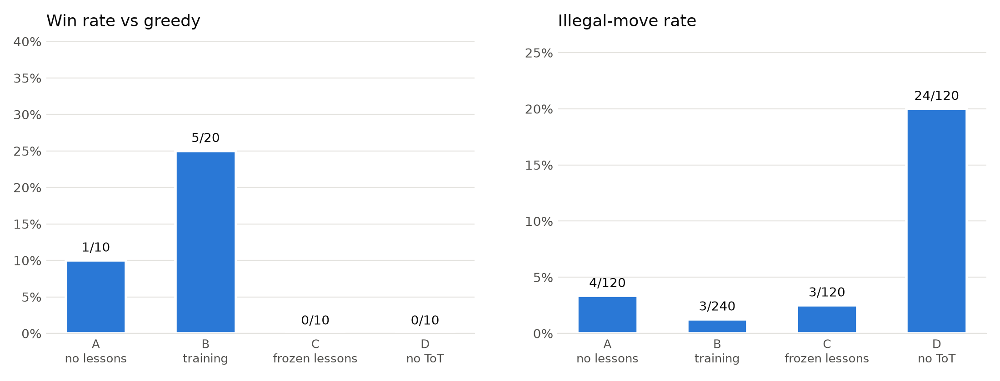
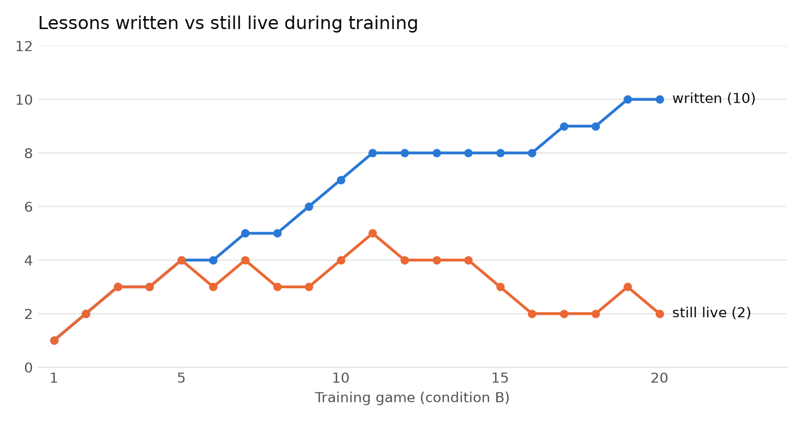

# Results: experiment seed 1

qwen3:32b (Ollama, local) as coral vs the greedy bot, first mover alternating. Run Nov 23, 2026 with:

```bash
uv run python scripts/run_experiment.py --seed 1 --a 10 --b 20 --c 10 --d 10
uv run --with matplotlib python scripts/make_charts.py runs/seed1 results/
```

| Cond | Lessons | Games | Win rate | Illegal moves | Picked top-scored move | Avg. cells at end |
|---|---|---|---|---|---|---|
| A | none | 10 | 1/10 (10%) | 4/120 (3%) | 72% | 8.4 |
| B | learning, review crew on | 20 | 5/20 (25%) | 3/240 (1%) | 82% | 9.3 |
| C | B's final store, frozen | 10 | 0/10 (0%) | 3/120 (2%) | 80% | 8.9 |
| D | C without tree-of-thought | 10 | 0/10 (0%) | 24/120 (20%) | – | 7.6 |





## What it shows

- **Tree-of-thought is what keeps moves legal.** Without it (D), illegal moves jump from 2% to 20%, and the agent ends with fewer cells.
- **The frozen lessons did not help.** C won 0/10 vs A's 1/10. The crew wrote 10 lessons during B, and the outcome tally retired 8 of them, so C ran with only 2 unproven lessons (L9 at 1 win, 2 losses; L10 at 0 wins, 1 loss).
- **B did best (5/20)**, but every B win came as first mover, and 20 games is too few to separate that from noise.
- **Seat matters more than anything else.** Across all 50 games the agent won 6 of 25 as first mover and 0 of 25 as second mover.

10 to 20 games per condition shows trends, not statistically significant differences.

## Files

| File | Contents |
|---|---|
| `summary.md`, `results.csv`, `log.txt` | The runner's summary table, one row per game, and one log line per game |
| `lessons-final.json` | The lesson store after B (all 10 lessons, 8 retired) that C and D used |
| `traces/` | One sample game per condition: turn records (`.json`) and OpenTelemetry spans (`.spans.json`). `s1-B-g016` is a win; `s1-D-g008` has 4 illegal moves |
